# W-Connect

[](https://github.com/Fallstop/w-connect/actions/workflows/build.yml)
[](https://github.com/Fallstop/w-connect/releases/latest)

A small, local controller for **Lian Li UNI FAN hubs**, on Linux and Windows. Native Rust background process, embedded browser UI, no Electron, Node runtime, account, cloud, or vendor software. SL v1 (`0cf2:a100`) is hardware-tested on Linux. Six additional USB IDs have explicit, opt-in experimental drivers; see the support matrix below.

- Four independent fan banks with measured RPM, editable names and fan counts.
- CPU, GPU, or hotter-of-both temperature curves; draggable graph and exact numeric editing.
- Quiet, balanced and performance presets; fixed speed and full-speed override.
- Hardware static color, breathing, rainbow, brightness and lights off. Existing lighting is preserved until changed. Applying lighting disables motherboard lighting sync and merged lighting globally.
- Light/dark/system appearance, reduced motion, configurable control interval, and profile import/export.
- Stable animations and keyboard focus, undo, exact hex colors, and saved-versus-applied feedback.
- Native lighting runs on the controller after the app exits while powered; saved profiles restore at startup. Permanent storage across power loss is unverified.
- Saved configuration, automatic reconnection, desktop launcher and background startup.
- Cooling continues when you close the page. UI changes are staged until **Save changes**.

The Linux executable is approximately **1.7 MB**; the Windows CPU sensor helper adds approximately 36 MB for its self-contained .NET runtime. **[Download the latest Linux or Windows release](https://github.com/Fallstop/w-connect/releases/latest)**, including installers and checksums.

## Screenshots

Current source build on Linux with a live SL v1 controller. The machine was under load, so temperature protection is visible. Curve and color edits are unsaved previews. Click an image for full size.

**Cooling workspace · Dark**

[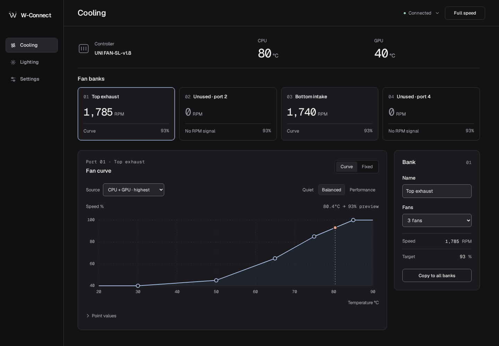](docs/screenshots/cooling-dark.png)

<table>
  <tr>
    <td width="50%" valign="top"><strong>Cooling · Light</strong><br><a href="docs/screenshots/cooling-light.png">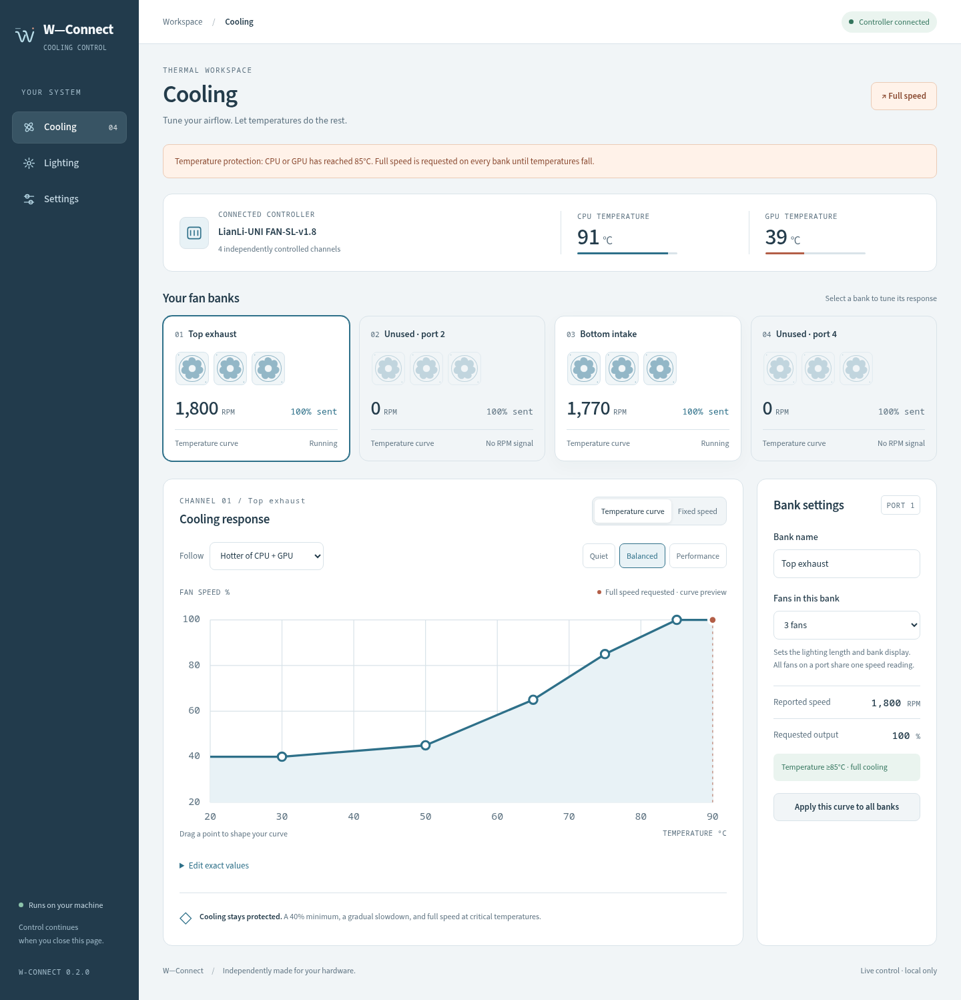</a></td>
    <td width="50%" valign="top"><strong>Exact curve editing</strong><br><a href="docs/screenshots/curve-editor.png">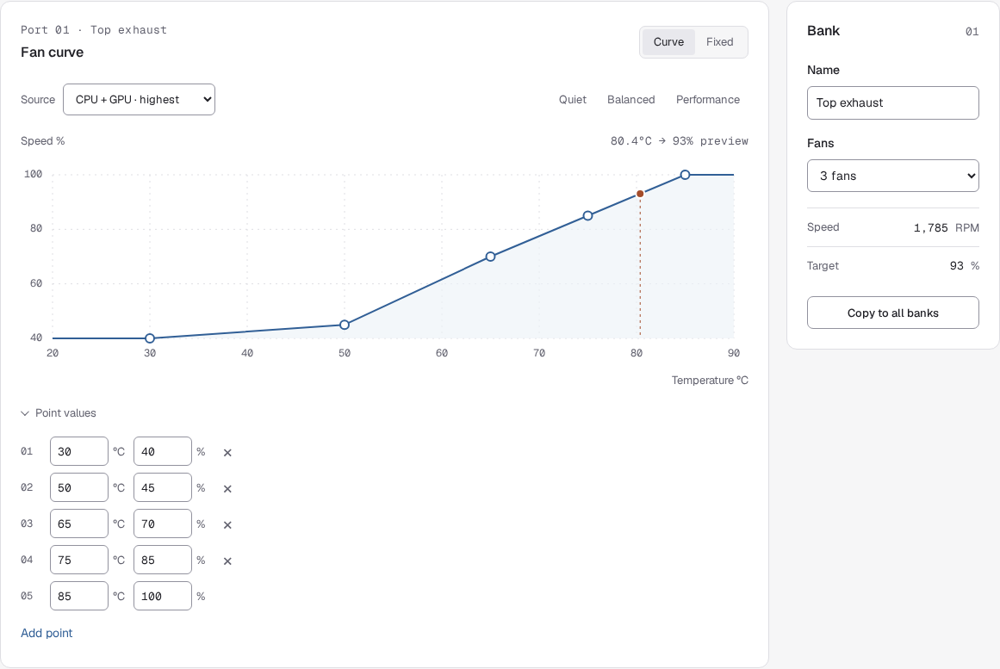</a></td>
  </tr>
  <tr>
    <td valign="top"><strong>Lighting · Dark</strong><br><a href="docs/screenshots/lighting-dark.png">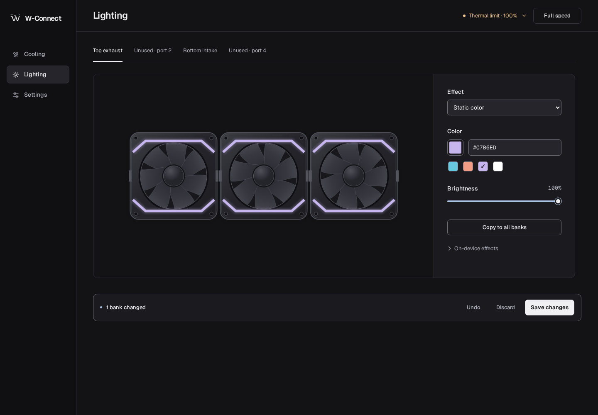</a></td>
    <td valign="top"><strong>Lighting · Light</strong><br><a href="docs/screenshots/lighting-light.png">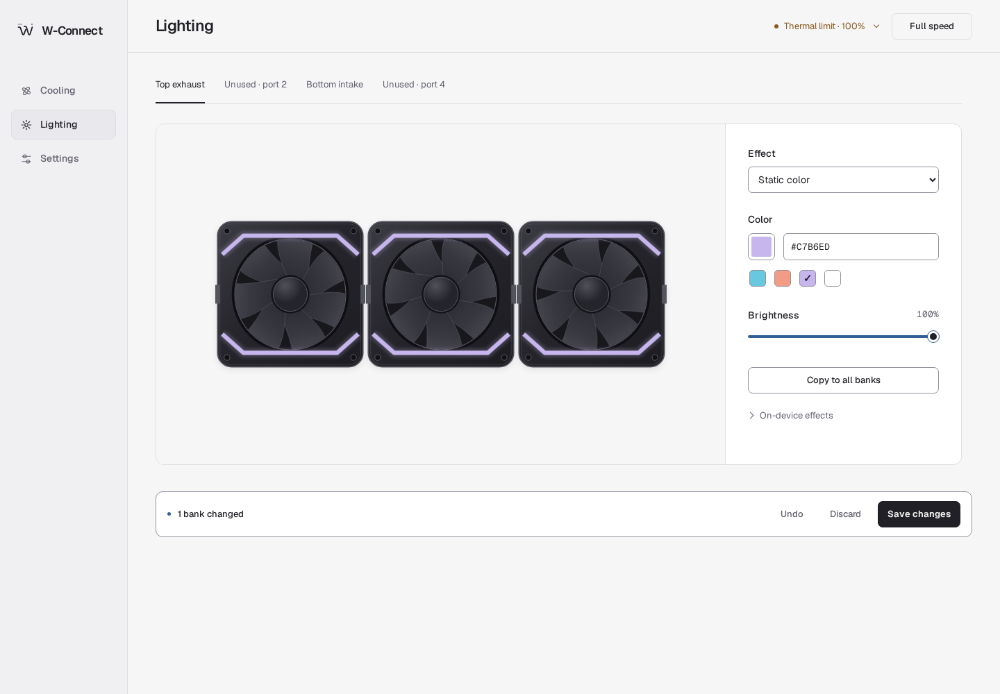</a></td>
  </tr>
  <tr>
    <td valign="top"><strong>Settings &amp; profiles</strong><br><a href="docs/screenshots/settings-light.png">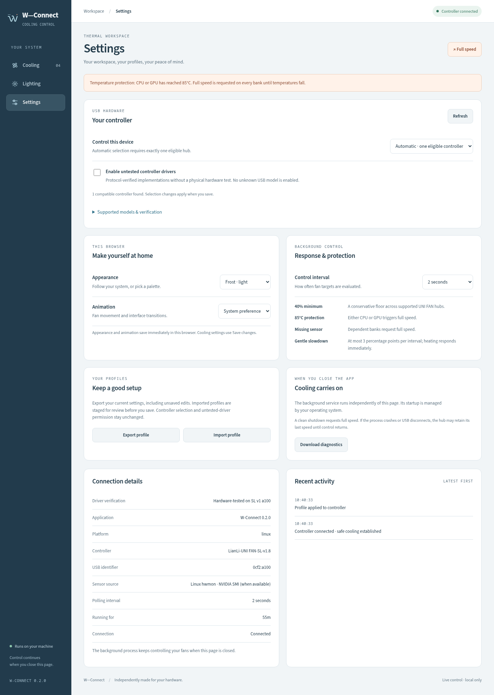</a></td>
    <td valign="top"><strong>Controller support</strong><br><a href="docs/screenshots/controller-support.png">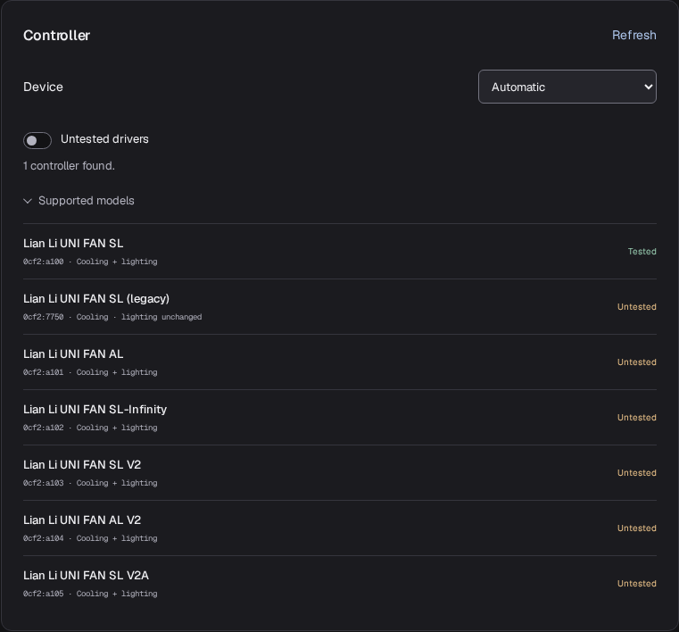</a></td>
  </tr>
  <tr>
    <td valign="top"><strong>Settings · Dark</strong><br><a href="docs/screenshots/settings-dark.png">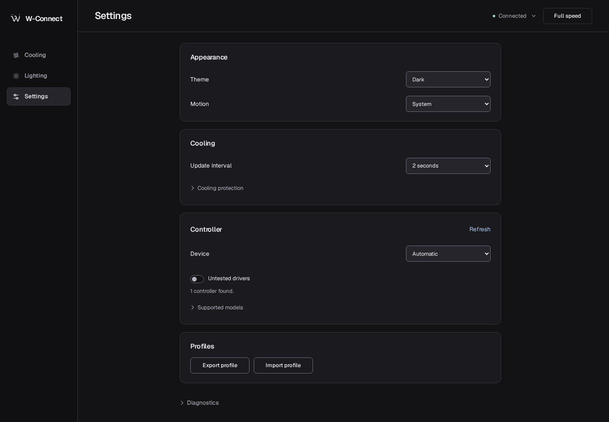</a></td>
    <td valign="top"><strong>Status details</strong><br><a href="docs/screenshots/status-detail.png">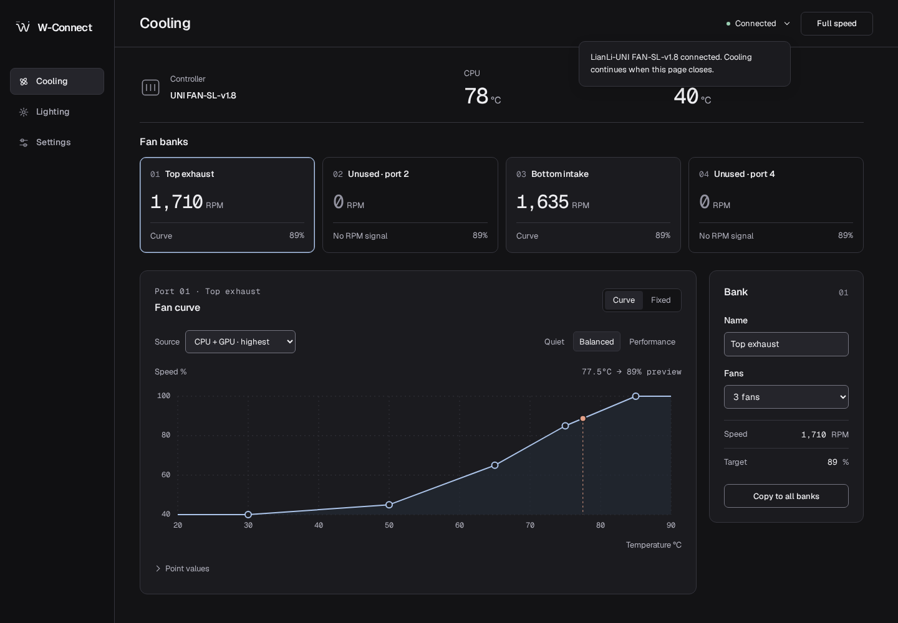</a></td>
  </tr>
</table>

<details>
<summary><strong>Narrow layouts · cooling and lighting at 390 px</strong></summary>

The same local interface adapts to smaller windows.

<a href="docs/screenshots/mobile-cooling.png">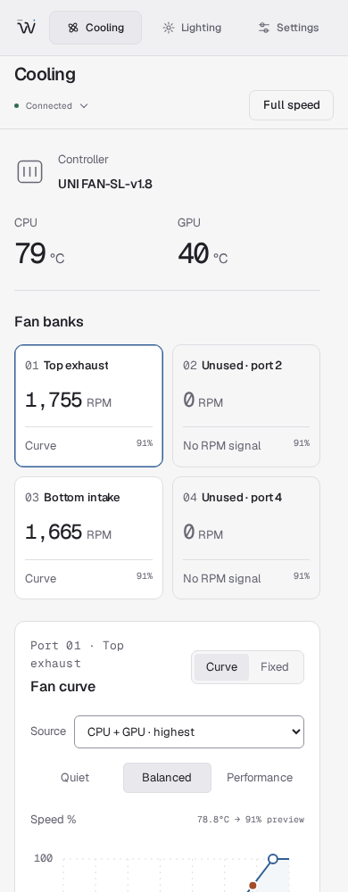</a>
<a href="docs/screenshots/mobile-lighting.png">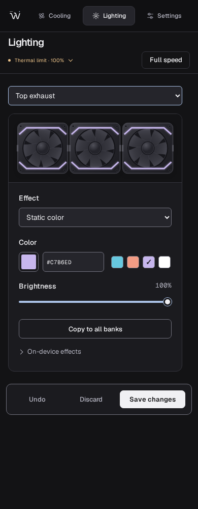</a>

</details>

<details>
<summary><strong>Native rainbow · SL frame lighting</strong></summary>

[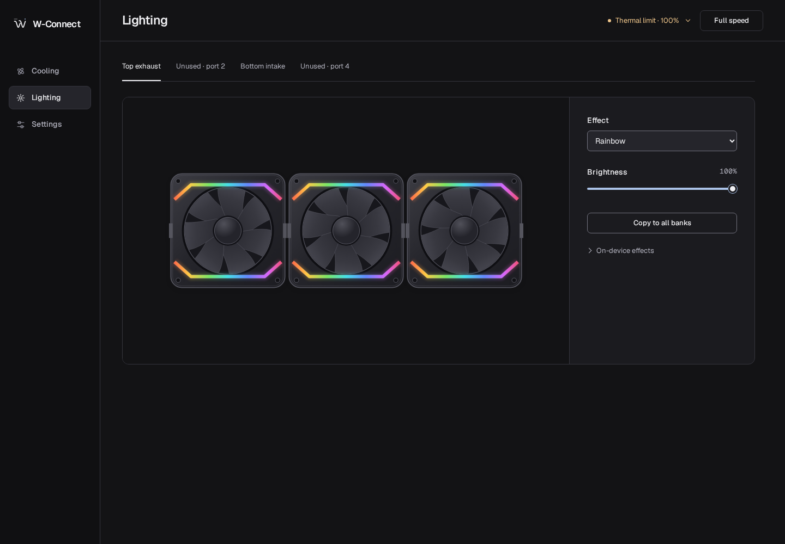](docs/screenshots/lighting-rainbow.png)

</details>

## Controller support

The default only activates the hardware-tested SL v1 `a100` model. In **Settings → Controller**, enable **Untested drivers**, choose a device if needed, then save. This is an explicit opt-in; importing a profile cannot grant it. Discovery is read-only, unknown IDs are rejected, and an ambiguous selection never chooses a hub arbitrarily. Only one controller is managed at a time. Switching first requests full speed on the previous hub; other unmanaged hubs are not changed.

| Model | USB PID (VID `0cf2`) | Validation |
| --- | --- | --- |
| UNI FAN SL v1 | `a100` | Linux hardware-tested |
| Legacy UNI FAN SL | `7750` | Prior-art-backed, hardware-untested; cooling only |
| UNI FAN AL v1 | `a101` | Vendor/prior-art-backed, hardware-untested |
| UNI FAN SL-Infinity | `a102` | Vendor/prior-art-backed, hardware-untested |
| UNI FAN SL V2 / V2A | `a103`, `a105` | Vendor/prior-art-backed, hardware-untested |
| UNI FAN AL V2 | `a104` | Vendor/prior-art-backed, hardware-untested |

These are separate protocol profiles, not ID aliases: AL changes the control register, V2 changes the RPM layout, legacy SL uses output reports, and RGB sequences vary by model. V2 profiles permit six fans per bank; older profiles permit four. Descriptor checks precede commands to untested devices. Windows releases are built and software-tested on Windows CI; none are claimed as physically verified on Windows. Wireless, TL, LCD, AIO/pump, firmware-update interfaces and `a106` are excluded.

See [controller-support.md](docs/controller-support.md) and the [independent protocol review](docs/extended-protocol-evidence.md). On Linux, rerun the USB access installer when upgrading from the original SL-only release. The application switch and USB permissions are separate; granting access does not activate an untested model.

## Linux

From a prebuilt archive, extract it and run `sudo sh scripts/install-usb-access.sh`, then `sh scripts/install-linux.sh` from the extracted folder. Requires Linux x64 with glibc 2.35 or newer, libudev and a systemd desktop session (Ubuntu 22.04 or newer, or a current comparable distribution). No compiler or Node runtime is needed.

To build from source, install Rust, a C compiler, pkg-config and libudev headers. For Debian/Ubuntu: `sudo apt install build-essential pkg-config libudev-dev`; Arch/Manjaro: `sudo pacman -S --needed base-devel pkgconf systemd`.

```sh
sudo sh scripts/install-usb-access.sh  # explicit supported-model USB permission
sh scripts/install-linux.sh           # release build + user service + launcher
```

Open **http://127.0.0.1:7676** or launch W-Connect from your application menu. The user service starts at login and restarts after crashes. USB permissions follow the active local login; this is not a pre-login system cooling service.

For development:

```sh
cargo run -- --open
cargo run -- --demo  # actual system temperatures, no USB reads/writes
cargo test --locked
# UI tests only (Node is not required to run the app):
npm --prefix web ci
npm --prefix web test
```

The Linux CPU reader supports `k10temp`, `coretemp`, `zenpower` and `k8temp`; AMD/Intel GPU hwmon and NVIDIA `nvidia-smi` supply GPU temperature. Highest available temperature is used within each category. Missing values are shown as unavailable, never invented. NVIDIA's driver must provide `nvidia-smi` on PATH.

## Windows

From a prebuilt archive, extract it, install the signed [PawnIO driver](https://pawnio.eu/), then run `powershell -ExecutionPolicy Bypass -File scripts/install-windows.ps1` in an elevated PowerShell. The archive includes the sensor helper.

To build from source, build with stable Rust and the MSVC toolchain: `cargo build --release --locked`. Build the small sensor helper using .NET 8:

```powershell
dotnet publish windows/Sensors/WConnect.Sensors.csproj -c Release -r win-x64 --self-contained true -o target/release/sensors
# Elevated PowerShell, once:
powershell -ExecutionPolicy Bypass -File scripts/install-windows.ps1
```

The installer copies files into Program Files, creates an elevated login task for the current user and a Start menu shortcut. CPU sensors require the separately installed [PawnIO driver](https://pawnio.eu/) and elevation through LibreHardwareMonitor; the web UI stays local. Close L-Connect and other controllers before use. No firmware updates or Windows USB driver replacement are needed. See [Windows sensor notes](windows/README.md). CI builds Linux and Windows packages; live Windows hardware validation is separate from Linux validation.

## Cooling behavior

The conservative application duty range is **40–100%**. Duty is the controller's raw percentage, not a promised fraction of maximum RPM. Every curve must rise monotonically and reach 100% by 85°C. At **85°C CPU or GPU**, all channels request full speed, including fixed profiles. If the selected sensor is absent, or temperature data is older than ten seconds, the affected banks request full speed. The “hotter of both” source requires both sensors; select CPU explicitly for a machine without a GPU sensor.

Rising fan speeds apply immediately; falling speeds decrease at most three percentage points per sample. Reconnection establishes 100% before restoring profiles. A clean process shutdown requests 100%. On USB failures, the app attempts full speed and reports that cooling cannot be confirmed. **The hub retains its last command if the process is killed abruptly, USB becomes inaccessible, or the OS hangs.** There is no verified firmware watchdog. Startup/restart mitigates a crash but cannot replace firmware-level thermal protection. Do not use this hub to control an unverified pump channel.

Zero RPM may indicate an unused channel or a stalled/disconnected fan; bank count is user-entered, not hardware discovery. The application cannot distinguish these cases. Fan telemetry is measured once per bank, not per physical fan.

## Configuration and local API

Config: `$XDG_CONFIG_HOME/w-connect/config.json` (normally `~/.config/w-connect/config.json`) or `%APPDATA%\w-connect\config.json`. Override with `W_CONNECT_CONFIG`. Invalid saved configuration refuses startup with a diagnostic rather than silently substituting a profile. Back up/edit only when the service is stopped. `--demo` shares configuration by default; use a separate `W_CONNECT_CONFIG` for a disposable preview.

Only `127.0.0.1:7676` is bound. Host, origin and fetch-site validation reject remote-site mutations and DNS rebinding. Mutations require JSON and `X-W-Connect: 1`; there is no remote access or CORS. Local programs on your machine can use the API.

- `GET /api/devices`: read-only discovery plus supported-model capabilities and verification status.
- `GET /api/state`: measured temperatures, RPM, requested/applied duties, connection, config and activity.
- `POST /api/config`: validate and persist a complete config. A successful save queues hardware application; activity confirms application or reports failure.
- `POST /api/resume`: return to the saved cooling profile.
- `POST /api/emergency`: latch 100% until Resume profile or the next configuration save (not persisted across restart).

## Development and evidence

The [fresh-context aesthetic review record](docs/design-review-neutral.md) separates visual judgments from behavioral checks and records every score. The earlier mixed-functionality 9.53 rating is not a claim about the current design.

Protocol: [docs/protocol.md](docs/protocol.md). Vendor analysis: [docs/vendor-reverse-engineering.md](docs/vendor-reverse-engineering.md). Hardware validation: [docs/validation.md](docs/validation.md). Tests cover the protocol, malformed packets, curve interpolation, thermal fallback, config validation and cross-origin write protection.

GitHub Actions checks both platforms on every push and pull request. Version tags publish the tested packages and SHA-256 checksums automatically. See [release maintenance](docs/releasing.md) for the packaging commands and tag procedure.

Primary prior art includes [liquidctl](https://github.com/liquidctl/liquidctl), [OpenRGB](https://gitlab.com/CalcProgrammer1/OpenRGB), [uni-sync](https://github.com/EightB1ts/uni-sync), and [lian-li-linux](https://github.com/sgtaziz/lian-li-linux). Protocol behavior was independently checked against the supplied L-Connect 3 v2.1.29 installer; no vendor binaries, extracted source, camera credentials or footage are shipped. LibreHardwareMonitor and other dependencies retain their own licenses.

## Remove

Linux: `systemctl --user disable --now w-connect`, remove `~/.config/systemd/user/w-connect.service`, `~/.local/bin/w-connect` and `~/.local/share/applications/w-connect.desktop`; run `systemctl --user daemon-reload`. Optionally remove `/etc/udev/rules.d/70-w-connect.rules` as root and reload udev rules. Configuration is kept unless removed manually.

Windows (elevated): stop and unregister the `W-Connect` scheduled task, remove `%ProgramFiles%\W-Connect` and the Start menu shortcut. Configuration remains in `%APPDATA%\w-connect`.
